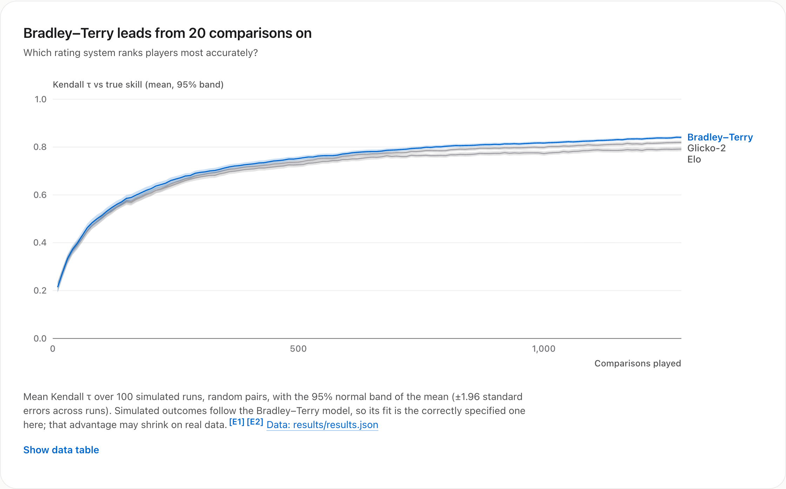

# pairwise-ratings

If all you can ask is "which of these two is better?", how fast can you recover the true ranking, and which pair should you ask about next? This project answers that with simulations of Elo, Glicko-2 and Bradley-Terry ratings and four rules for picking pairs.



## Highlights

- Picking which pair to compare next by information gain reaches the same ranking accuracy in **740 comparisons instead of 1,010** for random pairs: 270 fewer.
- The intuitive shortcuts backfire: always asking about the least-known player, or the most even matchup, leaves more runs stuck short of the target than random pairing.
- Bradley-Terry ranks best (rank agreement 0.841 out of 1) and Elo worst (0.792).
- Glicko-2 is written from Glickman's paper and reproduces its worked example to within 0.01 rating points.

## Run it

Requires [uv](https://docs.astral.sh/uv/) and make.

```sh
make setup     # install pinned dependencies
make test
make results   # 100 simulated runs, about 1 minute
make report    # interactive version of the chart above
```

## How it works

- Each run has 32 players with hidden skills and 1,280 simulated matches.
- Elo, Glicko-2 and Bradley-Terry each estimate the skills from the results.
- Ranking accuracy is Kendall tau, the share of player pairs ranked in the right order, rescaled so 1 is perfect; the target is 0.8.
- The information-gain rule picks the pair whose result would shrink Glicko-2's total uncertainty the most. That amount is known before the match is played.

## Limitations

- Skills stay fixed, so tracking players who improve or decline is untested.
- Match outcomes follow the same model the rating systems assume; real data is noisier.
- One pool size (32 players); the gain from smart pairing depends on it.
